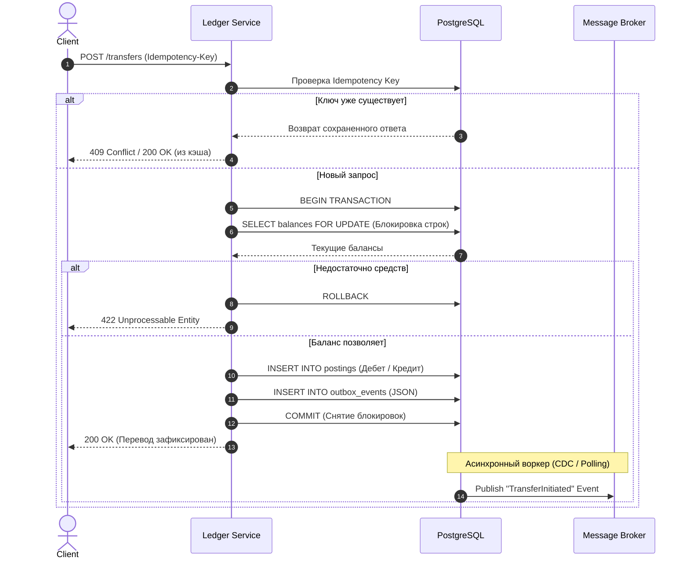

# 🏦 Core Billing Engine (Ledger Microservice)

## 📌 О проекте

**Core Billing Engine** — это отказоустойчивый микросервис финансового ядра (Ledger), отвечающий за проведение транзакций между счетами клиентов. 

Проект спроектирован с учетом требований к высоконагруженным банковским системам, опираясь на принципы **ACID-транзакционности**, строгой консистентности данных и асинхронного взаимодействия с внешними доменами.

## 🏗 Архитектурные паттерны и решения

### 1. Транзакционность и Финансовая консистентность
* **Решение:** Использование принципа двойной записи (Double-Entry Bookkeeping). Любой перевод средств формирует как минимум две записи в таблице проводок (`postings`): списание с одного счета (дебет) и зачисление на другой (кредит).
* **Защита от Race Conditions:** При проверке баланса перед переводом используется пессимистичная блокировка `SELECT ... FOR UPDATE`, исключающая уход баланса в минус при параллельных запросах.

### 2. Защита от дублей (Idempotency API)
* **Решение:** Имплементация заголовка `Idempotency-Key` на синхронном REST-слое.
* **Ценность:** Исключает риск двойного списания средств при многократном нажатии кнопки "Перевести" при сетевых таймаутах.

### 3. Гарантированная доставка событий (Transactional Outbox Pattern)
* **Решение:** Для решения проблемы "Dual-Write" применена таблица `outbox_events`. Запись бизнес-сущности и события для брокера происходит в одной БД-транзакции. 
* **Ценность:** Гарантия доставки (At-Least-Once) сообщений в смежные системы (Anti-Fraud, Notifications) через Apache Kafka.

---

## 📊 Sequence-диаграмма: Обработка транзакции

Ниже представлена диаграмма последовательности (UML Sequence), описывающая процесс перевода средств с проверкой идемпотентности, транзакционной блокировкой и асинхронной отправкой события.

---

## 🚦 Матрица HTTP-статусов и ошибок

Синхронный REST-интерфейс (`POST /transfers`) обрабатывает бизнес-логику и возвращает стандартизированные коды ответов:

| HTTP Код | Описание (Сценарий) |
| :--- | :--- |
| **200 OK** | Перевод успешно обработан и зафиксирован в ядре. |
| **400 Bad Request** | Ошибка валидации контракта (неверный формат UUID, сумма <= 0). |
| **409 Conflict** | Нарушение идемпотентности (попытка повторного запроса с тем же ключом, но другими параметрами транзакции). |
| **422 Unprocessable Entity** | Бизнес-ошибка: недостаточно средств на балансе отправителя. |
| **500 Internal Server Error** | Критический сбой сервера или отказ базы данных. |

---

## 📁 Структура репозитория

- `api/api-contract.yaml` — OpenAPI 3.0 спецификация (REST контракты)
- `db/schema.sql` — DDL скрипты (PostgreSQL: accounts, transactions, postings, outbox, триггеры, индексы)
- `docs/TransferInitiated.json` — JSON Schema для Kafka-событий (контракт для Anti-Fraud)